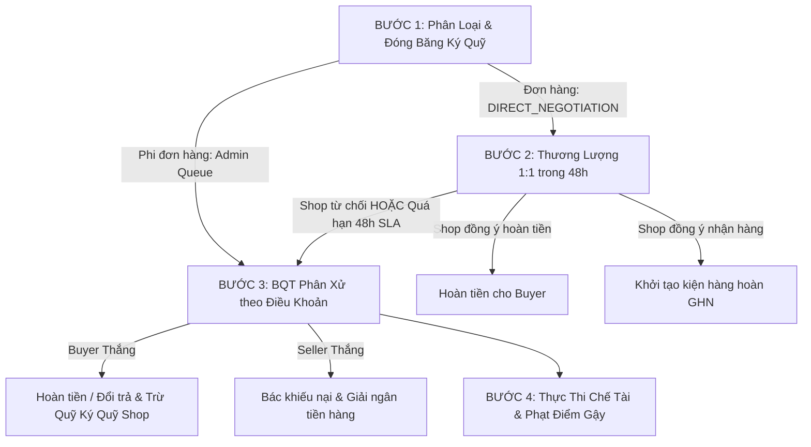

# QUY CHẾ HOẠT ĐỘNG, QUY TẮC NGHIỆP VỤ & ĐIỀU KHOẢN CHÍNH SÁCH
## SÀN THƯƠNG MẠI ĐIỆN TỬ ĐA NGÀNH OMNIMARKET (E-COMMERCE)

*Tài liệu ban hành căn cứ theo Nghị định số 52/2013/NĐ-CP, Nghị định số 85/2021/NĐ-CP, Nghị định số 13/2023/NĐ-CP và Luật Bảo vệ quyền lợi người tiêu dùng Việt Nam.*

---

## MỤC LỤC
1. [NGUYÊN TẮC CHUNG VÀ ĐỊNH NGHĨA](#1-nguyên-tắc-chung-và-định-nghĩa)
2. [QUY TẮC NGHIỆP VỤ ĐĂNG KÝ VÀ ĐỊNH DANH (EKYC)](#2-quy-tắc-nghiệp-vụ-đăng-ký-và-định-danh-ekyc)
3. [QUY CHẾ ĐĂNG BÁN SẢN PHẨM VÀ DANH MỤC HÀNG CẤM](#3-quy-chế-đăng-bán-sản-phẩm-và-danh-mục-hàng-cấm)
4. [CƠ CHẾ KÝ QUỸ THANH TOÁN BẢO VỆ NGƯỜI MUA (ESCROW)](#4-cơ-chế-ký-quỹ-thanh-toán-bảo-vệ-người-mua-escrow)
5. [CHÍNH SÁCH VẬN CHUYỂN VÀ GIAO NHẬN (GHN EXPRESS)](#5-chính-sách-vận-chuyển-và-giao-nhận-ghn-express)
6. [QUY TRÌNH 4 BƯỚC XỬ LÝ KHIẾU NẠI, ĐỔI TRẢ VÀ PHÂN XỬ TRANH CHẤP](#6-quy-trình-4-bước-xử-lý-khiếu-nại-đổi-trả-và-phân-xử-tranh-chấp)
7. [BIỂU PHÍ HOA HỒNG SÀN VÀ QUỸ KÝ QUỸ GIAN HÀNG (SHOP ESCROW FUND)](#7-biểu-phí-hoa-hồng-sàn-và-quỹ-ký-quỹ-gian-hàng-shop-escrow-fund)
8. [THANG PHẠT VI PHẠM VÀ HỆ THỐNG KỶ LUẬT LŨY TIẾN](#8-thang-phạt-vi-phạm-và-hệ-thống-kỷ-luật-lũy-tiến)
9. [CHÍNH SÁCH BẢO MẬT DỮ LIỆU CÁ NHÂN](#9-chính-sách-bảo-mật-dữ-liệu-cá-nhân)

---

## 1. NGUYÊN TẮC CHUNG VÀ ĐỊNH NGHĨA
- **Sàn Giao Dịch TMĐT OmniMarket (E-commerce)**: Là nền tảng thương mại điện tử đa ngành hàng tích hợp mô hình B2C và C2C, cung cấp hạ tầng giao dịch, cổng thanh toán trung gian ký quỹ (Escrow), tích hợp vận chuyển tự động và cơ chế giải quyết tranh chấp bảo vệ quyền lợi người dùng.
- **Người Mua (Buyer / Customer)**: Tổ chức hoặc cá nhân đăng ký tài khoản hợp lệ để mua sắm hàng hóa trên sàn.
- **Người Bán (Seller / Merchant)**: Thương nhân, tổ chức, hộ kinh doanh hoặc cá nhân đã hoàn thành thủ tục đăng ký gian hàng và xác thực định danh điện tử (eKYC) trên sàn.
- **Ban Quản Trị (BQT / Platform Admin)**: Đơn vị quản lý, giám sát vận hành, kiểm duyệt nội dung, điều phối tài chính và phán quyết tranh chấp độc lập.
- **Tài Khoản Ký Quỹ Escrow (Escrow Account)**: Hệ thống tài khoản ký quỹ trung gian độc lập giữ tiền thanh toán của Người mua cho đến khi giao dịch hoàn tất hoặc có phán quyết tranh chấp cuối cùng.

---

## 2. QUY TẮC NGHIỆP VỤ ĐĂNG KÝ VÀ ĐỊNH DANH (EKYC)

### 2.1. Đăng ký Tài khoản Người Dùng
- **BR-USR-01**: Người dùng phải từ đủ 15 tuổi trở lên hoặc có sự đồng ý của người giám hộ theo quy định pháp luật.
- **BR-USR-02 (Bắt buộc chấp thuận Điều khoản)**: Mọi cá nhân, tổ chức khi đăng ký tài khoản tại OmniMarket bắt buộc phải tích chọn xác nhận đã đọc, hiểu rõ và cam kết tuân thủ Điều khoản Dịch vụ và Chính sách Bảo mật này. Hệ thống từ chối khởi tạo tài khoản nếu không có sự đồng thuận.
- **BR-USR-03 (Xác thực 2 bước qua OTP)**: Đăng ký yêu cầu địa chỉ email chính chủ duy nhất. Hệ thống sẽ phát hành mã xác thực OTP 6 số qua email có hiệu lực trong vòng 15 phút.

### 2.2. Tiêu chuẩn Mở Gian Hàng & Định Danh eKYC
- **BR-MCH-01**: Người bán muốn mở gian hàng kinh doanh bắt buộc phải qua quy trình eKYC định danh điện tử tích hợp VNPT eKYC:
  1. Chụp ảnh 2 mặt Giấy tờ tùy thân (CCCD gắn chip / Hộ chiếu) còn hạn.
  2. Xác thực khuôn mặt sống (Liveness Detection) chống giả mạo Deepfake.
  3. Đối với Doanh nghiệp: Bắt buộc đính kèm Giấy phép đăng ký kinh doanh và Mã số thuế hợp lệ.
- **BR-MCH-02**: Địa chỉ kho lấy hàng và địa chỉ kho nhận hàng hoàn phải được chuẩn hóa theo danh mục Quận/Huyện/Phường của đối tác vận chuyển Giao Hàng Nhanh (GHN Express).

---

## 3. QUY CHẾ ĐĂNG BÁN SẢN PHẨM VÀ DANH MỤC HÀNG CẤM

### 3.1. Phân loại 8 Ngành Hàng Chính
Hệ thống hỗ trợ 8 đại ngành hàng lớn theo mô hình Shopee/Tiki:
1. *Điện Tử & Công Nghệ*
2. *Thời Trang & Phụ Kiện*
3. *Sách & Văn Phòng Phẩm*
4. *Nhà Cửa & Đời Sống*
5. *Sức Khỏe & Sắc Đẹp*
6. *Thể Thao & Dã Ngoại*
7. *Mẹ & Bé*
8. *Bách Hóa Online*

### 3.2. Tiêu chuẩn Phân Hạng Tình Trạng Sản Phẩm (Condition Grade)
- **BRAND_NEW (Chính hãng nguyên seal 100%)**: Còn nguyên tem niêm phong nhà sản xuất, bảo hành chính hãng.
- **GRADE_LIKE_NEW (Như mới 99%)**: Đã mở hộp, không trầy xước hoặc xước dăm siêu nhỏ, đầy đủ phụ kiện.
- **GRADE_VERY_GOOD (Rất tốt 95%)**: Có dấu hiệu sử dụng nhẹ, không ảnh hưởng thẩm mỹ và chức năng.
- **GRADE_GOOD (Tốt 90%)**: Cấn xước nhẹ, chức năng hoạt động hoàn hảo 100%.
- **GRADE_FAIR (Khá 80%)**: Ngoại hình trầy xước rõ, các tính năng chính ổn định.
- **GRADE_AS_IS (Thanh lý / Linh kiện)**: Bán theo hiện trạng, mô tả rõ lỗi hoặc bán xác linh kiện.

### 3.3. Danh Mục Hàng Hóa Cấm Kinh Doanh Tuyệt Đối
- Vũ khí quân dụng, súng đạn, vũ khí thô sơ, công cụ hỗ trợ.
- Chất ma túy, tiền chất ma túy, chất kích thích, thuốc lá điện tử, shisha.
- Hàng giả, hàng nhái, hàng vi phạm quyền sở hữu trí tuệ, phần mềm bẻ khóa.
- Động vật hoang dã nguy cấp, quý hiếm.
- Thực phẩm chức năng không rõ nguồn gốc, thuốc kê đơn y tế.
- Tài liệu phản động, mê tín dị đoan, văn hóa phẩm đồi trụy.

---

## 4. CƠ CHẾ KÝ QUỸ THANH TOÁN BẢO VỆ NGƯỜI MUA (ESCROW)

- **BR-ESC-01 (Bảo vệ 100% dòng tiền)**: Khi Người mua thanh toán (qua VNPay hoặc Ví điện tử sàn), toàn bộ số tiền thanh toán không chuyển ngay cho Người bán mà được lưu giữ tại Tài khoản Ký Quỹ Escrow (`status = HELD`).
- **BR-ESC-02 (Thời hạn 72h kiểm tra hàng)**: Sau khi đơn hàng chuyển sang trạng thái Đã Giao Hàng (`DELIVERED`), Người mua có 72 giờ để trải nghiệm và kiểm tra sản phẩm.
  - Nếu Người mua bấm **"Đã nhận hàng"**: Hệ thống lập tức giải ngân (`RELEASED`) tiền hàng vào ví Người bán sau khi khấu trừ hoa hồng sàn.
  - Nếu sau 72 giờ Người mua không phát sinh khiếu nại: Hệ thống tự động nghiệm thu và giải ngân cho Người bán.
- **BR-ESC-03 (Đóng băng tranh chấp)**: Bất kỳ thời điểm nào trước khi hoàn tất giải ngân, nếu Người mua gửi Khiếu nại (Report), trạng thái Escrow lập tức chuyển sang `DISPUTED` và bị khóa bất biến cho đến khi giải quyết xong.

---

## 5. CHÍNH SÁCH VẬN CHUYỂN VÀ GIAO NHẬN (GHN EXPRESS)

- **BR-SHP-01 (Tự động hóa cước vận chuyển)**: Hệ thống tích hợp trực tiếp GHN API để tính toán cước phí vận chuyển dựa trên khoảng cách địa lý thực tế từ Kho Người Bán đến Địa chỉ Người Mua.
- **BR-SHP-02 (Tách đơn hàng đa shop - Sub-Orders)**: Giỏ hàng chứa sản phẩm từ nhiều Shop khác nhau sẽ được tự động tách thành các đơn hàng độc lập, mỗi đơn có mã vận đơn GHN riêng biệt và lộ trình giao nhận độc lập.
- **BR-SHP-03 (Trách nhiệm đóng gói)**: Người bán có trách nhiệm đóng gói theo tiêu chuẩn vận chuyển thương mại điện tử (bọc xốp bóng khí chống sốc, dán tem cảnh báo hàng dễ vỡ, niêm phong băng keo có logo hoặc ký hiệu bảo mật).
- **BR-SHP-04 (Quyền đồng kiểm)**: Khi nhận hàng, Người mua được đồng kiểm ngoại quan cùng bưu tá GHN (kiểm tra tình trạng hộp ngoài, niêm phong). Khuyến cáo bắt buộc quay video mở hộp (Unbox Video) liên tục không cắt ghép để làm bằng chứng khiếu nại.

---

## 6. QUY TRÌNH 4 BƯỚC XỬ LÝ KHIẾU NẠI, ĐỔI TRẢ VÀ PHÂN XỬ TRANH CHẤP

### Bước 1: Tiếp Nhận & Phân Loại
- Khiếu nại Đơn hàng: Đóng băng ký quỹ sang `DISPUTED`, kích hoạt hạn thương lượng trực tiếp 48 giờ.
- Khiếu nại Người dùng / Shop / Đánh giá: Chuyển trực tiếp lên Ban Quản Trị sàn kiểm duyệt.

### Bước 2: Thương Lượng Trực Tiếp 1:1 (SLA 48 Giờ)
Người bán có 48 giờ để đưa ra một trong các phản hồi:
1. **ACCEPT_REFUND**: Chấp thuận hoàn tiền 100% cho Người mua giữ lại hàng.
2. **ACCEPT_RETURN**: Chấp thuận nhận lại hàng đổi trả, kích hoạt hạn 3 ngày gửi hàng hoàn.
3. **REJECT_AND_ESCALATE**: Từ chối khiếu nại, cung cấp giải trình và bằng chứng gửi lên BQT.
*Lưu ý: Nếu quá 48 giờ Người bán không phản hồi, hệ thống cron job tự động chuyển vụ việc lên BQT sàn phân xử theo diện bất hợp tác.*

### Bước 3: Ban Quản Trị Phân Xử Căn Cứ Điều Khoản
Phán quyết của Quản trị viên bắt buộc phải gắn mã Điều khoản Chính sách pháp lý:
- **Nhóm vi phạm Người Bán (Seller Fault)**:
  - *Điều khoản 8.2*: Hàng giả, hàng nhái, vi phạm quyền sở hữu trí tuệ.
  - *Điều khoản 9.1*: Hỏng hóc chức năng, lỗi kỹ thuật nhà sản xuất.
  - *Điều khoản 9.2*: Giao sai chủng loại, phân loại, màu sắc, mẫu mã.
  - *Điều khoản 9.3*: Thiếu phụ kiện, bộ phận hoặc quà tặng kèm cam kết.
  - *Điều khoản 10.2*: Người bán bất hợp tác hoặc quá hạn phản hồi SLA 48h.
- **Nhóm vi phạm Người Mua (Buyer Fault)**:
  - *Điều khoản 14.1*: Không cung cấp được video unbox hoặc bằng chứng thiếu căn cứ.
  - *Điều khoản 14.2*: Hư hỏng phát sinh do người mua sử dụng sai quy cách.
  - *Điều khoản 14.3*: Khiếu nại quá thời hạn bảo vệ 72 giờ theo quy định.
  - *Điều khoản 14.4*: Lạm dụng chính sách khiếu nại nhằm mục đích trục lợi.
- **Nhóm tranh chấp kiện hàng hoàn (Return Dispute - Shop khiếu nại kiện hoàn)**:
  - *Điều khoản 15.1*: Kiện hàng hoàn trả rỗng hoặc mất cắp ruột sản phẩm.
  - *Điều khoản 15.2*: Kiện hàng hoàn bị đánh tráo sang sản phẩm khác.
  - *Điều khoản 15.3*: Hàng hoàn về bị đập vỡ, biến dạng nặng do đóng gói ẩu.

### Bước 4: Thực Thi Chế Tài & Trừ Quỹ Ký Quỹ
- Trường hợp Người mua thắng: Hoàn tiền ngay vào ví người mua. Người bán phải chịu toàn bộ chi phí vận chuyển chiều trả hàng (khấu trừ trực tiếp vào Quỹ ký quỹ gian hàng `ShopEscrowFund`).

---

## 7. BIỂU PHÍ HOA HỒNG SÀN VÀ QUỸ KÝ QUỸ GIAN HÀNG (SHOP ESCROW FUND)

### 7.1. Phí Dịch Vụ và Hoa Hồng Sàn
- Phí hoa hồng tiêu chuẩn của sàn: Từ 5% đến 10% tùy thuộc theo từng danh mục ngành hàng.
- Chính sách chiết khấu thâm niên (Seniority Policy):
  - Gian hàng hoạt động trên 6 tháng với tỷ lệ hủy đơn < 1%: Giảm 0.5% hoa hồng.
  - Gian hàng hoạt động trên 12 tháng: Giảm 1.0% hoa hồng.
  - Gian hàng kim cương 5 sao: Hưởng mức trần ưu đãi hoa hồng cố định.

### 7.2. Quỹ Ký Quỹ Bảo Lãnh Gian Hàng (Shop Escrow Fund)
- Mọi gian hàng hoạt động bắt buộc duy trì số dư Quỹ ký quỹ bảo lãnh theo Cấp độ uy tín sao:
  - Hạng 1 sao: Tối thiểu 2.000.000 VNĐ.
  - Hạng 2 sao: Tối thiểu 3.500.000 VNĐ.
  - Hạng 3 sao: Tối thiểu 5.000.000 VNĐ.
  - Hạng 4 sao: Tối thiểu 7.500.000 VNĐ.
  - Hạng 5 sao: Tối thiểu 10.000.000 VNĐ.
- Khi xảy ra bồi thường hoặc phạt vi phạm, hệ thống tự động cấn trừ từ Quỹ này.
- **Quy định bù quỹ hụt (Deficit Top-up)**: Trong vòng 48 giờ kể từ khi quỹ bị âm hoặc dưới hạn mức, Người bán phải nạp bù đủ số dư. Nếu quá hạn:
  - Hạ bậc uy tín gian hàng.
  - Tạm khóa tính năng đăng bán sản phẩm mới.
  - Cố định lệnh rút tiền từ ví cho đến khi hoàn tất bổ sung quỹ.

---

## 8. THANG PHẠT VI PHẠM VÀ HỆ THỐNG KỶ LUẬT LŨY TIẾN

Hệ thống áp dụng cơ chế cộng dồn điểm vi phạm (Strikes Count) bất biến:
- **Từ 1 - 2 vi phạm**: Gửi cảnh báo hệ thống In-App, trừ 10 điểm uy tín.
- **Đạt 3 vi phạm (WARNED - Cảnh cáo)**: Gắn nhãn cảnh báo vàng trên hồ sơ gian hàng, giảm thứ hạng hiển thị sản phẩm trên thanh tìm kiếm.
- **Đạt 5 vi phạm (SUSPENDED - Đình chỉ tạm thời)**: Đình chỉ hoạt động tài khoản và gian hàng trong 14 ngày; toàn bộ sản phẩm bị ẩn khỏi sàn; tạm dừng tính năng rút tiền.
- **Đạt 7 vi phạm (BANNED - Khóa vĩnh viễn)**: Đóng vĩnh viễn gian hàng, tịch thu số dư quỹ ký quỹ bồi thường cho các bên bị hại; chuyển hồ sơ sang cơ quan chức năng có thẩm quyền nếu có dấu hiệu lừa đảo hình sự.
- **Cơ chế hồi phục (Decay Rule)**: Sau 30 ngày liên tục hoạt động chuẩn mực không phát sinh bất kỳ vi phạm nào, hệ thống tự động giảm trừ 1 điểm gậy vi phạm.

---

## 9. CHÍNH SÁCH BẢO MẬT DỮ LIỆU CÁ NHÂN

1. **Thu Thập Thông Tin**: Sàn chỉ thu thập các thông tin tối thiểu cần thiết để phục vụ giao dịch (Họ tên, SĐT, Email, Địa chỉ nhận hàng, Tọa độ giao hàng GHN, Dữ liệu eKYC đối với người bán).
2. **Mã Hóa & Bảo Mật**: Mật khẩu được băm một chiều an toàn bằng thuật toán BCrypt. Toàn bộ hình ảnh CCCD, giấy phép kinh doanh được lưu trữ trong Private Bucket tại hạ tầng MinIO/S3 với link chữ ký có thời hạn truy cập.
3. **Không Chia Sẻ Cho Bên Thứ Ba**: Sàn tuyệt đối không bán hoặc chia sẻ thông tin người dùng cho bất kỳ bên thứ ba nào ngoại trừ các đối tác vận chuyển (GHN), cổng thanh toán (VNPay) nhằm mục đích thực thi giao dịch, hoặc theo yêu cầu bằng văn bản từ cơ quan pháp luật có thẩm quyền.
4. **Quyền Của Người Dùng**: Người dùng có quyền truy cập, chỉnh sửa, yêu cầu trích xuất hoặc yêu cầu xóa dữ liệu tài khoản bất kỳ lúc nào bằng cách liên hệ Ban Quản Trị sàn.

---
*Bản Quy chế này có hiệu lực kể từ ngày ban hành và được cập nhật công khai trên toàn hệ thống OmniMarket.*
