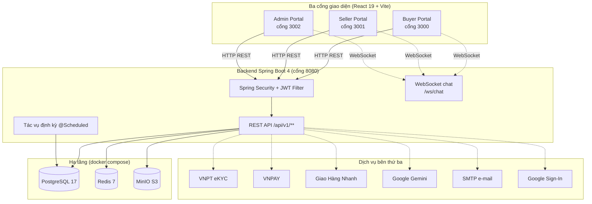

# NỀN TẢNG THƯƠNG MẠI ĐIỆN TỬ ĐA CỬA HÀNG TÍCH HỢP KÝ QUỸ, eKYC VÀ GỢI Ý CÁ NHÂN HÓA
## Intelligent E-commerce Marketplace — Nhóm SEP490_G87 (Đề tài FA26SE201)

> Sàn thương mại điện tử đa cửa hàng (multi-vendor) cho thiết bị công nghệ và linh kiện điện tử, tích hợp thanh toán an toàn qua **ký quỹ Escrow**, định danh người bán bằng sinh trắc học **VNPT eKYC**, vận chuyển **Giao Hàng Nhanh (GHN)**, thanh toán **VNPAY**, trợ lý mua sắm AI (**Google Gemini**) và **gợi ý sản phẩm cá nhân hóa**.

---

## 🏛️ KIẾN TRÚC ĐA CỔNG (BACKEND + 3 CỔNG GIAO DIỆN)

Hệ thống gồm một Backend API dùng chung và ba ứng dụng web riêng cho từng tác nhân:

| Phân hệ | Thư mục | Công nghệ chủ đạo | Cổng | Vai trò chính |
|:---|:---|:---|:---:|:---|
| **Backend Core API** | `ecommerce/` | Java 21, Spring Boot 4.0.1, Spring Security (JWT), Spring Data JPA, WebSocket | **8080** | REST API, WebSocket chat, nghiệp vụ Escrow – ví – hoa hồng, tác vụ định kỳ, tích hợp bên thứ ba |
| **Buyer Portal** | `ecommerce-fe/` | React 19.2, Vite, Tailwind CSS 4, Zustand 5, Axios | **3000** | Duyệt và tìm kiếm sản phẩm, giỏ hàng nhiều shop, thanh toán, theo dõi đơn, trả hàng/khiếu nại, ví, chat, trợ lý AI |
| **Seller Portal** | `ecommerce-seller-fe/` | React 19.2, Vite, Tailwind CSS 4, Zustand 5, Axios | **3001** | Đăng ký bán hàng với eKYC, quản lý sản phẩm – kho – voucher, xử lý đơn và trả hàng, quỹ ký quỹ, chat với khách |
| **Admin Portal** | `ecommerce-admin-fe/` | React 19.2, Vite, Tailwind CSS 4, Zustand 5, Axios | **3002** | Duyệt shop và sản phẩm, phân xử khiếu nại, hoa hồng – chính sách, giám sát Escrow và ví sàn, hỗ trợ trực tuyến |

Ngoài ra thư mục `automation-tests/` chứa bộ kiểm thử giao diện tự động (Playwright) độc lập với mã nguồn của các phân hệ trên.



---

## 🧰 CÔNG NGHỆ VÀ PHIÊN BẢN

| Lớp | Công nghệ |
|:---|:---|
| Ngôn ngữ / Runtime | Java 21; Node.js 20.19+ hoặc 22.12+ (yêu cầu của Vite) |
| Backend | Spring Boot 4.0.1, Spring Security, Spring Data JPA (Hibernate), Spring WebSocket, Maven Wrapper (Maven 3.9.12) |
| Cơ sở dữ liệu | PostgreSQL 17 (Hibernate `ddl-auto=create-drop`, xem mục khởi chạy) |
| Cache / giới hạn tần suất | Redis 7 (khóa giới hạn tần suất gửi báo cáo vi phạm và các thao tác của shop) |
| Lưu trữ tệp | MinIO (S3 tương thích), bucket công khai tên `ecommerce` |
| Frontend | React 19.2, Vite (rolldown-vite 7.2.5), Tailwind CSS 4.1, Zustand 5, Axios 1.13, React Router 7, Vitest 5 |
| Tích hợp ngoài | VNPT eKYC, VNPAY (sandbox), GHN, Google Gemini (gọi qua giao thức tương thích OpenAI), SMTP, Google OAuth2 |
| Kiểm thử | JUnit 5 + JaCoCo (backend), Vitest (frontend), Playwright (`automation-tests/`) |

---

## 🌟 ĐẶC TẢ CÁC NGHIỆP VỤ CỐT LÕI

### 1. Xác thực JWT và làm mới token đồng thời
- Đăng nhập bằng tên đăng nhập và mật khẩu (`POST /api/v1/auth/login`) hoặc Google (`POST /api/v1/auth/oauth2/google`); đăng ký có xác thực OTP qua e-mail (`/auth/register`, `/auth/verify`), có quên mật khẩu bằng OTP.
- Access token sống `JWT_EXPIRATION` mili-giây, refresh token sống `JWT_REFRESH_EXPIRATION` mili-giây (mẫu `.env`: 1 giờ và 7 ngày). Cấp lại token bằng `POST /api/v1/auth/refresh-token`.
- Ba vai trò: `CUSTOMER`, `BUSINESS` (người bán), `ADMIN`. Tài khoản `ADMIN` chỉ đăng nhập được ở Admin Portal.
- Phía frontend, Axios interceptor dùng **mutex**: khi nhiều request cùng nhận `401`, chỉ một request gọi `refresh-token`, các request còn lại chờ trong hàng đợi rồi gửi lại với token mới. Nếu refresh thất bại, `localStorage` và Zustand store được xóa và người dùng quay về trang đăng nhập.

### 2. Định danh người bán bằng sinh trắc học (VNPT eKYC)
Người dùng muốn mở shop phải hoàn tất phiên eKYC rồi gửi yêu cầu đăng ký bán hàng:
1. `POST /api/v1/kyc/sessions:start` — tạo phiên eKYC.
2. Tải ảnh CCCD mặt trước, mặt sau và ảnh khuôn mặt (`/kyc/session/{id}/upload`, `/kyc/session/{id}/attach`), phân loại giấy tờ (`/kyc/sessions/{id}/classify`).
3. `POST /api/v1/kyc/sessions/{id}/ocr/front`, `.../ocr/back` — bóc tách thông tin CCCD; `.../ocr/liveness` — kiểm tra khuôn mặt thật.
4. `POST /api/v1/kyc/sessions/{id}/compare` — so khớp khuôn mặt với ảnh trên CCCD. Phiên đạt khi độ tương đồng **từ 95% trở lên** (ngưỡng cố định trong mã nguồn).
5. `POST /api/v1/request/regis-seller` — gửi yêu cầu đăng ký bán hàng; Admin duyệt hoặc từ chối (`PUT /api/v1/request/approve`, `PUT /api/v1/request/reject`). Khi được duyệt, tài khoản trở thành `BUSINESS` và shop được tạo.

### 3. Ký quỹ giao dịch (Escrow)
- Tiền người mua thanh toán (ví nội bộ hoặc VNPAY) được **giữ ở tài khoản Escrow của sàn**, chưa chuyển cho người bán.
- Giải ngân cho người bán (sau khi trừ hoa hồng sàn) khi:
  * Người mua bấm xác nhận đã nhận hàng (`PATCH /api/v1/order/{orderId}/received`), hoặc
  * Tác vụ định kỳ `autoMarkReceivedOrders` (chạy mỗi giờ) tự đánh dấu đã nhận và giải ngân cho đơn `DELIVERED` quá **3 ngày** mà người mua không xác nhận.
- Admin có thể can thiệp thủ công: `POST /api/v1/escrow/orders/{orderId}/release`, `.../refund`, `.../split-settle`.

### 4. Khiếu nại, trả hàng và phân xử
- **Khiếu nại (Report):** người mua gửi khiếu nại đơn hàng trong vòng **3 ngày** kể từ khi đơn được giao (`POST /api/v1/report`). Hai bên thương lượng trực tiếp trong **48 giờ** (`seller-respond`); quá hạn hoặc không đồng ý thì hồ sơ chuyển lên Admin (`escalate` hoặc tự động).
- **Trả hàng (Return):** vòng đời `WAITING_FOR_SHIPMENT` → `SHIPPED` (người mua nhập mã vận đơn, `POST /returns/{id}/tracking`) → `RETURNED` (hàng về shop, `.../confirm-delivered`) → `COMPLETED` hoặc `DISPUTED`; trạng thái còn lại là `CANCELLED`.
  * Người mua có **3 ngày** để gửi hàng trả; quá hạn, yêu cầu tự hủy.
  * Khi hàng về shop, người bán có **72 giờ** kiểm tra: đồng ý hoàn tiền (`POST /returns/{id}/complete`) hoặc khiếu nại tráo hàng/hư hỏng kèm bằng chứng (`POST /returns/{id}/dispute`). Quá 72 giờ không phản hồi, hệ thống tự hoàn tiền cho người mua.
  * Khi `DISPUTED`, Admin phân xử (`POST /returns/{id}/resolve-dispute`): `APPROVE_RETURN` hoàn tiền cho người mua; `REJECT_RETURN` hủy yêu cầu và giải ngân cho người bán.
- **Kỷ luật shop:** vi phạm có thể dẫn tới đình chỉ shop/tài khoản **14 ngày**; hết hạn, tác vụ định kỳ tự khôi phục (shop chuyển `WARNED`, sản phẩm được mở bán lại). Tài khoản bị khóa có thể gửi kháng cáo (`POST /api/v1/request/ban-review`).

### 5. Hoa hồng và uy tín cửa hàng
- Công thức: **phí hoa hồng = max(ngưỡng sàn, tỷ lệ cơ bản − ưu đãi ký quỹ − ưu đãi thâm niên)**.
- Tỷ lệ cơ bản: hàng không phải mới (`GRADE_NEW`) dùng mức hàng cũ; hàng mới dùng tỷ lệ của danh mục (hoặc danh mục cha); chưa cấu hình thì dùng tỷ lệ chuẩn toàn sàn. Giá trị mặc định khi seed: chuẩn **5,0%**, hàng cũ **6,0%**, ngưỡng sàn **1,5%**; Admin chỉnh trong trang Hoa hồng.
- Ưu đãi ký quỹ theo 5 cấp uy tín (sao) dựa trên số dư quỹ ký quỹ của shop: dưới 1 triệu → 1 sao (0%); 1–5 triệu → 2 sao (0,2%); 5–20 triệu → 3 sao (0,5%); 20–50 triệu → 4 sao (1,0%); từ 50 triệu → 5 sao (1,5%).
- Ưu đãi thâm niên cho shop hoạt động liên tục không vi phạm: từ 3 tháng giảm 0,2%; từ 6 tháng giảm 0,5%; từ 12 tháng giảm 1,0%.
- Shop thiếu quỹ so với cấp uy tín được thông báo và có hạn nạp bù; quá hạn, hệ thống tự giáng cấp uy tín.

### 6. Gợi ý sản phẩm cá nhân hóa
- Dịch vụ gợi ý chấm điểm tất định (không dùng embedding): tổng 100 điểm gồm danh mục (40), mức giá (30), tình trạng máy (15), bảo hành (10), sản phẩm nổi bật (5).
- Cá nhân hóa dựa trên lịch sử tìm kiếm và lịch sử xem của người dùng; người dùng mới (cold-start) nhận danh sách mặc định.
- Các điểm vào: `GET /api/v1/recommendations`, `/recommendations/similar/{productId}`, `/recommendations/accessories/{productId}`, `POST /recommendations/track`.

### 7. Chat và trợ lý AI
- **Chat thời gian thực** giữa người mua – người bán – hỗ trợ sàn dùng **WebSocket thuần** (endpoint `/ws/chat`, bản có tiền tố `/api/v1/ws/chat?token=<access token>`), kèm REST `/api/v1/chat/threads/**` cho luồng hội thoại, tin nhắn, ảnh và video.
- **Trợ lý mua sắm AI:** `POST /api/v1/chat/ai` gọi Google Gemini qua giao thức tương thích OpenAI (`AI_BASE_URL`, mặc định endpoint `/v1beta/openai` của Gemini; mô hình lấy từ `GEMINI_VERSION` hoặc `AI_MODEL`). Khách vãng lai được tư vấn sản phẩm; người đã đăng nhập còn hỏi được về đơn hàng và voucher của mình.
- **Chatbot kịch bản:** `GET /api/v1/chat/init`, `POST /api/v1/chat/interact`.

---

## 🏃 HƯỚNG DẪN KHỞI CHẠY TOÀN BỘ HỆ THỐNG

### 1. Yêu cầu cài đặt
- **JDK 21** (Maven đã kèm Maven Wrapper `mvnw`, không cần cài Maven; lần chạy đầu cần Internet để tải phụ thuộc).
- **Node.js 20.19+ hoặc 22.12+** (kèm `npm`).
- **Docker Desktop** đã bật Docker engine.

### 2. Tạo file `ecommerce/.env`
Backend và `docker-compose.yml` cùng đọc file `ecommerce/.env` (file này nằm trong `.gitignore`, mỗi máy phải tự tạo). Quy tắc: mỗi dòng một cặp `KEY=value`, không có khoảng trắng quanh dấu `=`, dấu `#` chỉ đặt ở đầu dòng chú thích, **mọi biến phải có giá trị khác rỗng** (nếu không backend dừng với lỗi `Could not resolve placeholder`).

```env
# PostgreSQL (docker-compose.yml và backend)
POSTGRES_DB=ecommerce_db
POSTGRES_USER=postgres
POSTGRES_PASSWORD=<mat-khau-tu-chon>
POSTGRES_PORT=5432

# MinIO
MINIO_ROOT_USER=minioadmin
MINIO_ROOT_PASSWORD=minioadmin
MINIO_API_PORT=9000
MINIO_BUCKET_NAME=ecommerce

# Redis
REDIS_HOST=localhost
REDIS_PORT=6379

# JWT: chuỗi Base64 giải mã ra tối thiểu 32 byte (openssl rand -base64 32)
JWT_SECRET=<chuoi-base64>
JWT_EXPIRATION=3600000
JWT_REFRESH_EXPIRATION=604800000

# VNPAY sandbox
VNPAY_TMN_CODE=<tmn-code>
VNPAY_HASH_SECRET=<hash-secret>
VNPAY_URL=https://sandbox.vnpayment.vn/paymentv2/vpcpay.html
VNPAY_RETURN_URL=http://localhost:8080/api/v1/payment/vnpay/return

# VNPT eKYC
VNPT_EKYC_BASE_URL=https://api.idg.vnpt.vn
VNPT_EKYC_ACCESS_TOKEN=<access-token>
VNPT_EKYC_TOKEN_ID=<token-id>
VNPT_EKYC_TOKEN_KEY=<token-key>

# Giao Hàng Nhanh
GHN_URL=https://online-gateway.ghn.vn
GHN_TOKEN=<ghn-token>
GHN_SHOP_ID=<ghn-shop-id>

# SMTP (OTP đăng ký, quên mật khẩu)
MAIL_HOST=smtp.gmail.com
MAIL_PORT=587
MAIL_USERNAME=<dia-chi-email>
MAIL_PASSWORD=<mat-khau-ung-dung-khong-dau-cach>

# Google Gemini (trợ lý AI)
GEMINI_API_KEY=<gemini-api-key>
GEMINI_VERSION=gemini-2.5-flash

# Đăng nhập Google
GOOGLE_CLIENT_ID=<client-id>
GOOGLE_CLIENT_SECRET=<client-secret>
GOOGLE_CALLBACK_URL=http://localhost:8080/login/oauth2/code/google
```

Ghi chú:
- `MINIO_ROOT_PASSWORD` tối thiểu 8 ký tự; mật khẩu ứng dụng Gmail ghi liền, không có dấu cách.
- Thay toàn bộ phần nằm trong dấu `<...>` bằng giá trị thật của bạn. `POSTGRES_PASSWORD`, `JWT_SECRET` và `MINIO_ROOT_PASSWORD` phải là giá trị hợp lệ ngay từ đầu.
- Biến tùy chọn (có giá trị mặc định): `FRONTEND_URL` (mặc định `http://localhost:3000`), `SELLER_FRONTEND_URL` (mặc định `http://localhost:3001`), `AI_BASE_URL`, `AI_API_KEY`, `AI_MODEL`.
- Các khóa dịch vụ ngoài (VNPAY, eKYC, GHN, SMTP, Gemini, Google) chỉ cần khóa thật khi dùng chức năng tương ứng; điền giá trị giữ chỗ không rỗng là đủ để backend khởi động.

### 3. Khởi động hạ tầng (PostgreSQL, Redis, MinIO)
```bash
cd ecommerce
docker compose up -d
docker compose ps -a
```
Docker Compose tạo các container `app-postgres` (PostgreSQL 17), `app-redis` (Redis 7), `app-minio` (MinIO) và `app-minio-init` (chạy một lần để tạo bucket `MINIO_BUCKET_NAME` rồi thoát). Địa chỉ: PostgreSQL `localhost:5432`, Redis `localhost:6379`, MinIO API `localhost:9000`, MinIO Console `http://localhost:9001`.

### 4. Khởi động Backend
```bash
cd ecommerce
# Windows
.\mvnw.cmd spring-boot:run
# Linux / macOS
chmod +x mvnw && ./mvnw spring-boot:run
```
- Backend lắng nghe tại `http://localhost:8080` và tự đọc `ecommerce/.env`.
- **Không cần chạy script SQL.** Cấu hình `spring.jpa.hibernate.ddl-auto=create-drop` khiến Hibernate tạo toàn bộ bảng khi khởi động và xóa khi dừng; ngay sau đó `DatabaseSeeder` và `DataInitializer` (hai `CommandLineRunner`) nạp dữ liệu mẫu. Mỗi lần chạy lại là một cơ sở dữ liệu mới hoàn toàn.
- Khởi động xong khi console in `Started EcommerceApplication` rồi `=== Database Seeding Completed Successfully! ===`. Kiểm tra nhanh:
  ```bash
  curl http://localhost:8080/api/v1/category
  ```

### 5. Khởi động ba cổng giao diện (mỗi cổng một terminal)
```bash
# Buyer Portal  -> http://localhost:3000
cd ecommerce-fe && npm install && npm run dev

# Seller Portal -> http://localhost:3001
cd ecommerce-seller-fe && npm install && npm run dev

# Admin Portal  -> http://localhost:3002
cd ecommerce-admin-fe && npm install && npm run dev
```
Cổng của từng ứng dụng được cố định trong `vite.config.js`; địa chỉ API mặc định `http://localhost:8080` nên không cần file `.env` cho frontend. Biến tùy chọn: `VITE_API_URL` (đổi địa chỉ backend, cả ba cổng), `VITE_GOOGLE_CLIENT_ID` và `VITE_SELLER_URL` (chỉ Buyer Portal; mặc định `http://localhost:3001`).

### 6. Dừng và đặt lại
Nhấn `Ctrl+C` ở các terminal, rồi trong thư mục `ecommerce`:
```bash
docker compose down        # dừng container, giữ volume
docker compose down -v     # xóa cả volume (cần khi đổi POSTGRES_DB hoặc POSTGRES_PASSWORD)
```

---

## 🔑 TÀI KHOẢN MẪU (DO SEEDER TẠO KHI KHỞI ĐỘNG)

Đăng nhập bằng **tên đăng nhập** (không dùng e-mail). Tài khoản `admin` chỉ đăng nhập được ở Admin Portal.

| Cổng | Tên đăng nhập | Mật khẩu | Vai trò | Họ tên / Cửa hàng |
|:---|:---|:---|:---:|:---|
| Admin (3002) | `admin` | `admin123@` | `ADMIN` | Quản Trị Viên Sàn E-commerce |
| Seller (3001) | `seller1` | `seller123@` | `BUSINESS` | Nguyễn Thành Đạt — Apple Authorised Reseller |
| Seller (3001) | `seller2` | `seller123@` | `BUSINESS` | Trần Quang Huy — Samsung Experience Store |
| Seller (3001) | `seller3` | `seller123@` | `BUSINESS` | Lê Minh Tuấn — GearVN PC & Gaming Hub |
| Seller (3001) | `seller4` | `seller123@` | `BUSINESS` | Phạm Gia Long — Sony Electronics Flagship |
| Seller (3001) | `seller5` | `seller123@` | `BUSINESS` | Ngô Hoàng Bách — Anker & Baseus Flagship Store |
| Seller (3001) | `seller6` | `seller123@` | `BUSINESS` | Vũ Đình Nam — Xiaomi Smart Ecosystem VN |
| Buyer (3000) | `customer1` | `customer123@` | `CUSTOMER` | Lê Văn Mua Hàng |
| Buyer (3000) | `customer2` | `customer123@` | `CUSTOMER` | Phạm Thị Mua Sắm |
| Buyer (3000) | `customer3` | `customer123@` | `CUSTOMER` | Nguyễn Văn An |
| Buyer (3000) | `customer4` | `customer123@` | `CUSTOMER` | Đỗ Thùy Trang |
| Buyer (3000) | `customer5` | `customer123@` | `CUSTOMER` | Bùi Minh Quân |

Dữ liệu mẫu kèm theo gồm danh mục, sản phẩm, voucher, ví nội bộ, địa chỉ giao hàng, giỏ hàng, yêu cầu đăng ký bán hàng, đơn hàng và đánh giá.

---

## ⏰ TÁC VỤ ĐỊNH KỲ (`@Scheduled`)

Backend có 7 tác vụ nền; tất cả đều khóa bản ghi (`findByIdForUpdate`) trước khi đổi trạng thái để an toàn khi chạy song song với thao tác của người dùng.

| Lớp xử lý | Phương thức | Chu kỳ (cron) | Chức năng |
|:---|:---|:---:|:---|
| `OrderServiceImpl` | `autoMarkReceivedOrders` | mỗi giờ (`0 0 * * * *`) | Đơn `DELIVERED` quá 3 ngày mà người mua chưa xác nhận: tự đánh dấu đã nhận và giải ngân Escrow cho người bán |
| `OrderReturnServiceImpl` | `processExpiredBuyerShipments` | 10 phút (`0 */10 * * * *`) | Người mua quá 3 ngày chưa gửi hàng trả: hủy yêu cầu trả hàng |
| `OrderReturnServiceImpl` | `processExpiredSellerInspections` | 10 phút | Người bán quá 72 giờ không xác nhận hoặc khiếu nại hàng trả về: tự hoàn tiền cho người mua |
| `ReportServiceImpl` | `processExpiredDirectNegotiations` | 10 phút | Quá 48 giờ thương lượng trực tiếp mà người bán không phản hồi: chuyển hồ sơ cho Admin |
| `ShopEscrowFundServiceImpl` | `downgradeExpiredDeficits` | 10 phút | Shop thiếu quỹ ký quỹ quá hạn nạp bù: giáng cấp uy tín theo số dư hiện có |
| `ShopServiceImpl` | `processExpiredSuspensions` | 10 phút | Shop hết 14 ngày đình chỉ: chuyển sang `WARNED`, mở bán lại sản phẩm |
| `AccountDisciplineServiceImpl` | `processExpiredSuspensions` | 10 phút | Tài khoản hết 14 ngày đình chỉ: khôi phục trạng thái hoạt động |

### Bảng các mốc thời gian nghiệp vụ

| Quy tắc | Thời hạn |
|:---|:---:|
| Người mua xác nhận đã nhận hàng, nếu không hệ thống tự xác nhận và giải ngân | 3 ngày sau khi giao |
| Người mua gửi khiếu nại đơn hàng | trong 3 ngày sau khi giao |
| Thương lượng trực tiếp giữa người mua và người bán | 48 giờ |
| Người mua gửi hàng trả sau khi yêu cầu được chấp nhận | 3 ngày |
| Người bán kiểm tra hàng trả về | 72 giờ |
| Đình chỉ shop / tài khoản | 14 ngày |
| Hạn tối thiểu độ tương đồng khuôn mặt eKYC | 95% |

---

## 🧪 KIỂM THỬ

| Phạm vi | Lệnh | Ghi chú |
|:---|:---|:---|
| Backend (JUnit 5, Mockito) | `cd ecommerce && ./mvnw test` | 98 lớp kiểm thử đơn vị; JaCoCo ghi dữ liệu độ phủ vào `target/` |
| Frontend (Vitest 5) | `cd ecommerce-fe && npx vitest run` (tương tự cho `ecommerce-seller-fe`, `ecommerce-admin-fe`) | `npm run test` chạy ở chế độ theo dõi (watch) |
| Giao diện tự động (Playwright) | `cd automation-tests && npm install && npm test` | 5 luồng nghiệp vụ, xem `automation-tests/README.md` |

---

## 🔗 TÀI LIỆU CHI TIẾT TỪNG PHÂN HỆ

- ⚙️ [Backend Spring Boot — kiến trúc, đồng thời, API](ecommerce/README.md)
- 🛒 [Buyer Portal (cổng 3000)](ecommerce-fe/README.md)
- 🏪 [Seller Portal (cổng 3001)](ecommerce-seller-fe/README.md)
- 🛡️ [Admin Portal (cổng 3002)](ecommerce-admin-fe/README.md)
- 🧪 [Kiểm thử giao diện tự động (Playwright)](automation-tests/README.md)
- 📜 [Quy chế hoạt động, quy tắc nghiệp vụ và điều khoản chính sách](BUSINESS_RULES_AND_POLICIES.md)
