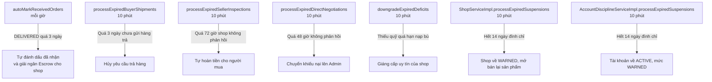

# TÀI LIỆU KỸ THUẬT BACKEND (SPRING BOOT 4)
## E-commerce Core API — Java 21, ký quỹ Escrow và kiểm soát đồng thời

> Backend là lõi của nền tảng: quản lý tài khoản – phân quyền (JWT), sản phẩm và kho, giỏ hàng – đơn hàng – thanh toán, **ký quỹ Escrow** và ví nội bộ, khiếu nại – trả hàng – phân xử, định danh **VNPT eKYC**, vận chuyển **GHN**, chat thời gian thực, trợ lý AI và gợi ý sản phẩm. Hướng dẫn chạy toàn hệ thống (cả ba cổng giao diện) nằm ở [README gốc](../README.md); tài liệu này tập trung vào backend.

---

## 🛠️ CÔNG NGHỆ

| Thành phần | Chi tiết |
|:---|:---|
| Ngôn ngữ / Framework | Java 21; Spring Boot 4.0.1 (Web MVC, Security, Data JPA, WebSocket, Validation, Data Redis, Mail, Thymeleaf); jjwt; MinIO Java client; Lombok |
| Cơ sở dữ liệu | PostgreSQL 17, schema do Hibernate sinh (`spring.jpa.hibernate.ddl-auto=create-drop`) từ 47 thực thể JPA |
| Cache / giới hạn tần suất | Redis 7 (`StringRedisTemplate`: khóa giới hạn tần suất gửi báo cáo vi phạm, thao tác của shop) |
| Lưu trữ tệp | MinIO (S3 tương thích): ảnh sản phẩm, bằng chứng khiếu nại, ảnh/video chat |
| Realtime | WebSocket thuần: `/ws/chat` và `/api/v1/ws/chat?token=<access token>` |
| Xác thực | JWT (access + refresh, thư viện jjwt), đăng nhập Google qua `POST /api/v1/auth/oauth2/google`, OTP e-mail; phân quyền `CUSTOMER`, `BUSINESS`, `ADMIN` |
| Tích hợp ngoài | VNPAY (chữ ký HMAC-SHA512), GHN, VNPT eKYC, Google Gemini (giao thức tương thích OpenAI), SMTP |
| Cấu hình | `application.properties` đọc biến từ `ecommerce/.env` qua `DotEnvConfig` |
| Kiểm thử | JUnit 5, Mockito, JaCoCo (98 lớp kiểm thử) |

API được đánh phiên bản bằng `ApiVersioningConfig`: mọi controller khai báo `version = "1"` nên đường dẫn thực tế có tiền tố `/api/v1`.

---

## 🏛️ CẤU TRÚC MÃ NGUỒN

Mã nguồn chia theo miền nghiệp vụ (mỗi miền có `controller`, `service` + `service/impl`, `repository`, `entity`, `dto`, `valueObjects` khi cần):

```text
src/main/java/com/marketplace/ecommerce/
├── auth/            # Tài khoản, người dùng, vai trò, địa chỉ, đăng nhập/đăng ký/OTP/Google, kỷ luật tài khoản
├── kyc/             # Phiên eKYC: tải ảnh, OCR mặt trước/sau, liveness, so khớp khuôn mặt (ngưỡng 95%)
├── shop/            # Cửa hàng, quỹ ký quỹ (ShopEscrowFund), cấp uy tín (TrustLevelConfig), đình chỉ shop
├── product/         # Danh mục, sản phẩm, biến thể, ảnh, lịch sử tồn kho, kiểm duyệt sản phẩm
├── cart/            # Giỏ hàng nhiều shop
├── voucher/         # Voucher sàn (PLATFORM) và voucher shop (SHOP): PERCENTAGE, FIXED_AMOUNT, FREE_SHIPPING
├── order/           # Báo giá và xác nhận thanh toán (checkout), đơn hàng, trả hàng (OrderReturn)
├── payment/         # VNPAY, Escrow (giữ – giải ngân – hoàn tiền – chia tiền)
├── wallet/          # Ví nội bộ, thông tin ngân hàng, yêu cầu rút tiền
├── platform/        # Cấu hình sàn, hoa hồng (Commission), chính sách thâm niên, chính sách nền tảng
├── request/         # Yêu cầu (đăng ký bán hàng, cập nhật shop, rút tiền, kháng cáo) và báo cáo/khiếu nại (Report)
├── review/          # Đánh giá sản phẩm và phản hồi của shop
├── shipping/        # Tích hợp GHN: tỉnh/huyện/xã, phí vận chuyển, tạo đơn; quản trị phí ship
├── webhook/         # Webhook trạng thái giao hàng từ GHN
├── chat/            # Chat thời gian thực (WebSocket + REST), chatbot kịch bản
├── chatbot/         # Trợ lý mua sắm AI (Gemini) và tải tệp trong hội thoại AI
├── recommendation/  # Gợi ý sản phẩm: cá nhân hóa, tương tự, phụ kiện, theo dõi hành vi
├── notification/    # Thông báo trong ứng dụng
├── social/          # Theo dõi cửa hàng (ShopFollower)
├── wishlist/        # Danh sách yêu thích
├── statistics/      # Thống kê và phân tích cho người mua, người bán, Admin
├── file/            # Dịch vụ tệp (MinIO)
├── common/          # BaseEntity, ErrorResponse, xử lý ngoại lệ toàn cục
└── config/          # SecurityConfig, JwtFilter, DotEnvConfig, MinIOConfig, VNPayConfig, GHNConfig, EKycConfig,
                     # ApiVersioningConfig, DataInitializer và thư mục seed/ (DatabaseSeeder + 14 seeder)
```

### Khởi tạo dữ liệu
`DatabaseSeeder` gọi lần lượt 14 seeder trong `config/seed`: vai trò, người dùng (12 tài khoản mẫu: 1 admin, 6 người bán, 5 người mua — xem bảng ở README gốc), danh mục, shop, cấu hình sàn, chính sách, ví, giỏ hàng, địa chỉ giao hàng, sản phẩm, voucher, yêu cầu đăng ký bán hàng, đơn hàng và đánh giá. `DataInitializer` là runner bổ sung cùng loại. Cả hai là `CommandLineRunner` chạy mỗi lần khởi động và đều kiểm tra bản ghi đã tồn tại trước khi tạo.

---

## 🔒 KIỂM SOÁT ĐỒNG THỜI VÀ BẢO VỆ DÒNG TIỀN

### 1. Khóa bi quan (Pessimistic Locking)
12 repository khai báo truy vấn khóa ghi `PESSIMISTIC_WRITE` với tên `findByIdForUpdate` (hoặc biến thể): `AccountRepository`, `ChatThreadRepository`, `EscrowRepository`, `OrderRepository`, `OrderReturnRepository`, `ProductRepository`, `ProductVariantRepository`, `ReportRepository`, `ReviewRepository`, `ShopEscrowFundRepository`, `ShopRepository`, `WalletRepository`.

```java
@Lock(LockModeType.PESSIMISTIC_WRITE)
@Query("select p from Product p where p.id = :id")
Optional<Product> findByIdForUpdate(@Param("id") UUID id);
```

- Trừ/hoàn tồn kho khi đặt hoặc hủy đơn khóa dòng `Product`/`ProductVariant`, nên hai giao dịch không thể cùng bán vượt số lượng còn lại.
- Mọi thao tác tiền (`WalletServiceImpl`, `EscrowServiceImpl`) khóa ví người mua, ví người bán và ví hệ thống Escrow (`findByUserIdForUpdate`, `findSystemWalletForUpdate`) trong cùng một giao dịch, tránh số dư âm và giải ngân hai lần.
- Các tác vụ định kỳ và thao tác chuyển trạng thái (đơn, trả hàng, báo cáo, quỹ ký quỹ, shop, tài khoản) đều đọc lại bản ghi bằng khóa trước khi quyết định.

### 2. Làm mới token an toàn khi có nhiều request đồng thời
- Backend: `POST /api/v1/auth/refresh-token` kiểm tra refresh token và cấp lại cặp token mới; refresh token rỗng, sai hoặc hết hạn bị từ chối với thông báo yêu cầu đăng nhập lại.
- Frontend: Axios interceptor dùng mutex (một request refresh duy nhất, các request `401` khác xếp hàng rồi gửi lại), xem README của từng cổng.
- Tài khoản bị khóa nhận token giới hạn chỉ dùng để gửi kháng cáo (`POST /api/v1/request/ban-review`), không có refresh token và không có quyền marketplace.

---

## ⏰ TÁC VỤ ĐỊNH KỲ



| Lớp | Phương thức | Cron | Chu kỳ |
|:---|:---|:---:|:---:|
| `OrderServiceImpl` | `autoMarkReceivedOrders` | `0 0 * * * *` | mỗi giờ |
| `OrderReturnServiceImpl` | `processExpiredBuyerShipments` | `0 */10 * * * *` | 10 phút |
| `OrderReturnServiceImpl` | `processExpiredSellerInspections` | `0 */10 * * * *` | 10 phút |
| `ReportServiceImpl` | `processExpiredDirectNegotiations` | `0 */10 * * * *` | 10 phút |
| `ShopEscrowFundServiceImpl` | `downgradeExpiredDeficits` | `0 */10 * * * *` | 10 phút |
| `ShopServiceImpl` | `processExpiredSuspensions` | `0 */10 * * * *` | 10 phút |
| `AccountDisciplineServiceImpl` | `processExpiredSuspensions` | `0 */10 * * * *` | 10 phút |

---

## 📡 DANH MỤC REST API

Tiền tố chung `/api/v1`. Phân quyền theo vai trò dùng `@PreAuthorize`; nhãn *(ADMIN)*, *(BUSINESS)* bên dưới là các điểm vào bị giới hạn vai trò trong mã nguồn. Danh sách dưới đây là các nhóm chính, không liệt kê toàn bộ.

### 1. Tài khoản và xác thực — `/auth`, `/user`, `/address`
- `POST /auth/register`, `POST /auth/verify` — đăng ký và xác thực OTP e-mail
- `POST /auth/login`, `POST /auth/oauth2/google` — đăng nhập (tên đăng nhập hoặc Google)
- `POST /auth/refresh-token` — cấp lại cặp token
- `POST /auth/forgot-password/send-otp`, `POST /auth/forgot-password/reset` — quên mật khẩu
- `GET /auth/me`; `GET /auth/users` *(ADMIN)*
- `GET|PUT /user/me`, `PUT /user/password`; sổ địa chỉ `/address` (CRUD, `PATCH /address/{id}/default`)

Backend **không** có endpoint đăng xuất: đăng xuất là thao tác xóa token ở phía frontend.

### 2. Định danh eKYC — `/kyc`
`POST /kyc/sessions:start`, `POST /kyc/session/{id}/upload`, `POST /kyc/session/{id}/attach`, `POST /kyc/sessions/{id}/classify`, `POST /kyc/sessions/{id}/ocr/front`, `.../ocr/back`, `.../ocr/liveness`, `POST /kyc/sessions/{id}/compare`, `POST /kyc/sessions/{id}/fullFlow-upload`, `GET /kyc/sessions/{id}`.

### 3. Yêu cầu và khiếu nại — `/request`, `/report`
- `POST /request/regis-seller` — đăng ký bán hàng; `POST /request/ban-review`, `GET /request/ban-review/status` — kháng cáo khóa tài khoản
- `GET /request`, `GET /request/{id}`; *(ADMIN)* `GET /request/admin`, `PUT /request/approve`, `PUT /request/reject`
- `POST /report` — gửi khiếu nại; `PUT /report/{id}/cancel`; *(BUSINESS)* `POST /report/{id}/seller-respond`; `POST /report/{id}/escalate`; *(ADMIN)* `PUT /report/{id}/handle`; `GET /report/by-order/{orderId}`, `GET /report/policy-clauses`

### 4. Sản phẩm, giỏ hàng, voucher, đánh giá
- Công khai: `GET /product`, `GET /product/{id}`, `GET /product/{id}/similar`, `GET /product/shop/{shopId}/featured`, `GET /category`, `GET /vouchers`, `GET /vouchers/shop/{shopId}`
- Người bán: `POST|PUT|DELETE /seller/...`, `GET /seller/by-shop`, `PATCH /seller/{id}/featured`; ảnh sản phẩm `/product/image/**`; lịch sử tồn kho `/inventory-history`
- Admin: `GET /admin/products/pending`, `POST /admin/products/{id}/approve|reject`; `PUT /category/{id}/commission-rate`
- Giỏ hàng: `GET /cart`, `POST /cart/items`, `POST /cart/items/{id}/plus|minus`, `DELETE /cart/items/{id}`
- Voucher: `GET /vouchers/my-vouchers`, `POST /vouchers/{id}/claim`, `POST /vouchers/calculate`; quản lý `POST|PUT|DELETE /vouchers`, `GET /vouchers/shop-manage` *(BUSINESS)*, `GET /vouchers/platform-manage` *(ADMIN)*
- Đánh giá: `/review/products/{productId}`, `POST /review/products/{productId}/reviews`, `/review/reviews/{id}`, `/review/my-reviews`; phản hồi của shop `/reply/reviews/reply`
- Yêu thích và theo dõi: `/wishlist/toggle/{productId}`, `/wishlist/my`; `/social/shop/toggle-follow/{shopId}`

### 5. Đặt hàng và giao vận — `/checkout`, `/order`, `/shipping`, `/webhooks/ghn`
- `POST /checkout/quote` — báo giá; `GET /checkout/confirm` — xác nhận kết quả thanh toán
- `POST /order` — tạo đơn theo từng shop; `PATCH /order/{id}/status`; `PATCH /order/{id}/received` — người mua xác nhận đã nhận
- `POST /order/{id}/ghn/retry`, `PUT /order/{id}/ghn/code` — đồng bộ mã vận đơn GHN
- `GET /order/me`, `GET /order/{id}/me` (người mua); `GET /order/shops`, `GET /order/shops/orders/{id}` (người bán); `GET /order`, `GET /order/{id}`, `GET /order/shop-ranking` *(ADMIN)*
- `GET /shipping/provinces|districts|wards`, `POST /shipping/fee`; `GET /shipping-fees`, `GET /shipping-fees/summary` (quản trị phí ship)
- `POST /webhooks/ghn` — GHN gọi về cập nhật trạng thái giao hàng

### 6. Thanh toán, Escrow, ví — `/payment`, `/escrow`, `/wallet`
- `POST /payment/orders/{orderId}/vnpay` — tạo URL thanh toán VNPAY; `GET /payment/vnpay/return` — VNPAY chuyển hướng về sau thanh toán (backend xác minh chữ ký HMAC-SHA512)
- *(ADMIN)* `GET /escrow`, `POST /escrow/orders/{id}/release|refund|split-settle`; `GET /escrow/orders/{id}/settlement`
- `GET /wallet/me`, `PUT /wallet/bank-info`, `POST /wallet/withdraw`, `GET /wallet/withdrawals`, `POST /wallet/withdrawals/{id}/cancel`
- *(ADMIN)* `GET /wallet/admin`, `GET /wallet/admin/withdrawals`, `POST /wallet/admin/withdrawals/{id}/approve|reject`

### 7. Trả hàng và phân xử — `/returns`
`POST /returns/batch`, `GET /returns/{id}`, `GET /returns/order/{orderId}`, `POST /returns/{id}/tracking`, `POST /returns/{id}/confirm-delivered`, `POST /returns/{id}/confirm-returned`, `POST /returns/{id}/complete` *(BUSINESS)*, `POST /returns/{id}/dispute` *(BUSINESS)*, `POST /returns/{id}/resolve-dispute` *(ADMIN)*.

### 8. Cửa hàng, quỹ ký quỹ, hoa hồng, chính sách
- Cửa hàng: `GET /shop/{shopId}`, `GET /shop/my-shop`, `GET /shop/my-violations`, `PATCH /shop/my-shop/escrow-status`
- Quỹ ký quỹ shop (`/shop-escrow-fund`, bí danh `/shop/escrow-funds`): `GET /my-fund`, `GET /my-fund/transactions`, `POST /top-up`, `POST /vnpay/create-payment`, `POST /request-refund`; Admin: `GET /admin`, `POST /admin/{shopId}/deduct`, `PUT /admin/{shopId}/adjust`, duyệt hoặc từ chối yêu cầu đóng shop và hoàn quỹ
- Cấp uy tín: `GET /trust-levels`; Admin `GET /trust-levels/admin`, `PUT /trust-levels/admin/{starLevel}`, `POST /trust-levels/admin/reset-defaults`
- Hoa hồng và cấu hình sàn: `GET|PATCH /platform`, `GET /platform/all`, `PUT /platform/setting`, `GET /platform/commission/calculate-preview`; thâm niên `GET /platform/seniority-policies`, `/platform/seniority-policies/admin`; thống kê `/commissions/overview|by-month|by-category|top-sellers`
- Chính sách hiển thị: `GET /policies`, `GET /policies/{key}`; Admin `/admin/policies`

### 9. Chat, AI, gợi ý, thông báo, thống kê
- `GET|POST /chat/threads/**`, `/chat/messages/{id}`, `POST /chat/upload` — chat REST; WebSocket tại `/ws/chat`
- `POST /chat/ai` — trợ lý AI; `GET /chat/init`, `POST /chat/interact` — chatbot kịch bản
- `GET /recommendations`, `GET /recommendations/similar/{id}`, `GET /recommendations/accessories/{id}`, `POST /recommendations/track`
- `GET /notifications/my`, `GET /notifications/unread-count`, `PUT /notifications/{id}/read`, `PUT /notifications/read-all`
- `GET /statistics/admin/dashboard`, `/statistics/admin/shops/performance` *(ADMIN)*; `GET /statistics/seller/dashboard`; `GET /statistics/buyer/spending`

---

## 🧪 BUILD VÀ KIỂM THỬ

Chạy trong thư mục `ecommerce` (Windows dùng `.\mvnw.cmd`, Linux/macOS dùng `./mvnw`):

```bash
# Chạy backend ở chế độ phát triển (cần docker compose up -d và file .env)
./mvnw spring-boot:run

# Đóng gói JAR, bỏ qua kiểm thử
./mvnw clean package -DskipTests

# Chạy toàn bộ kiểm thử đơn vị (JUnit 5 + Mockito)
./mvnw test
```

- Bộ kiểm thử gồm 98 lớp trong `src/test`; JaCoCo (cấu hình trong `pom.xml`, loại trừ DTO, entity, enum, hằng số) ghi dữ liệu độ phủ vào `target/jacoco.exec` và báo cáo vào `target/site/jacoco`.
- Báo cáo kiểm thử của đồ án: `Report5_Unit_Test.xlsx` (kiểm thử đơn vị) và `Report5_Test_Report.xlsx` (kiểm thử hệ thống) trong thư mục `02_Bao_cao`.
